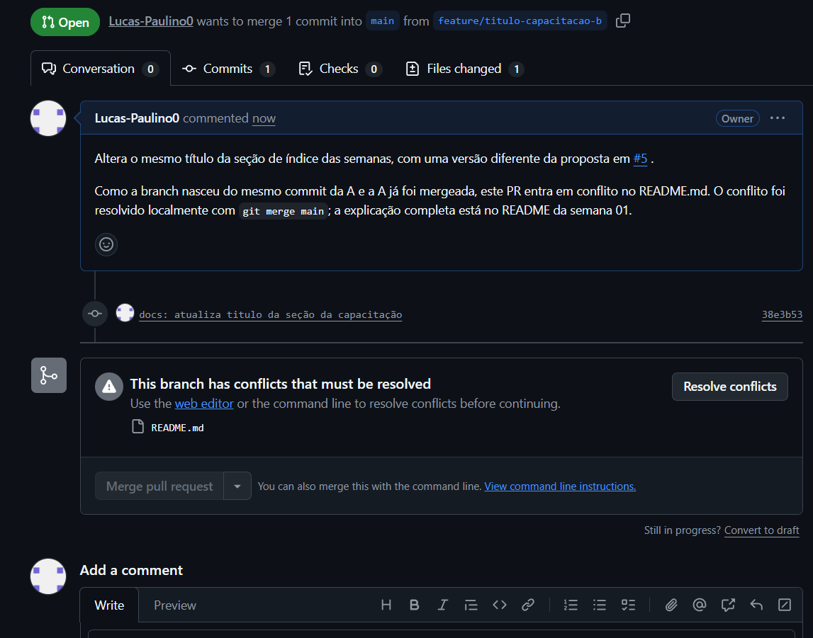
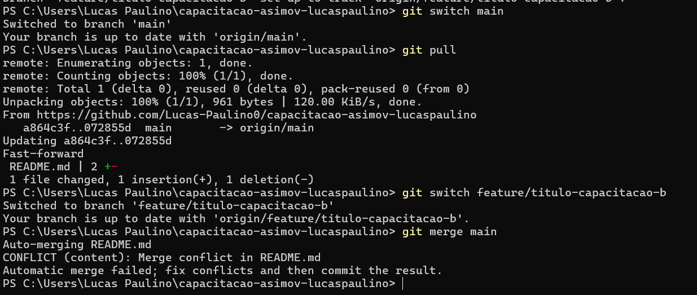
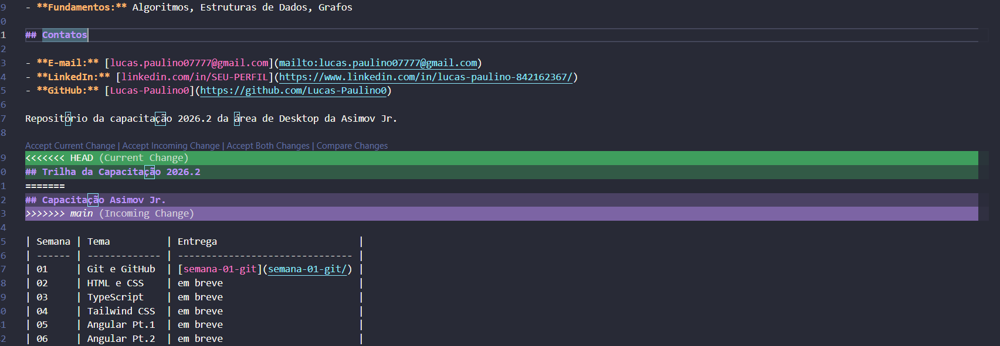
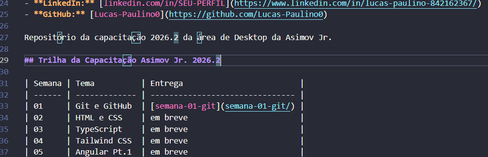
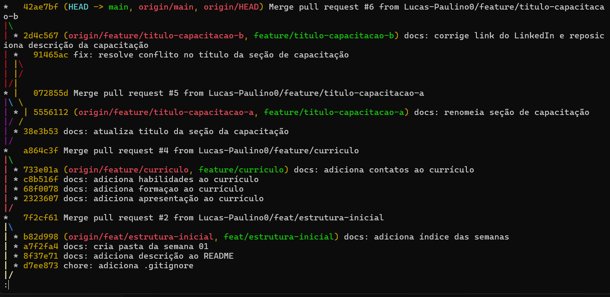
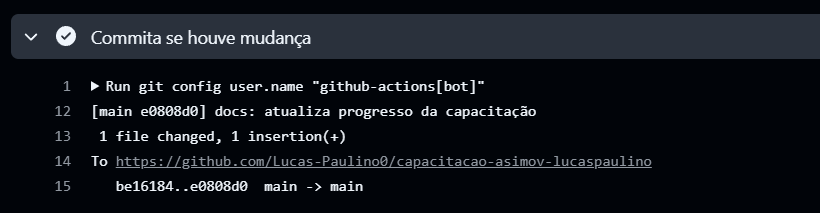

# Semana 01 - Git e GitHub

## O que foi feito

- Criação do repositório `capacitacao-asimov-lucaspaulino`, com `.gitignore` e estrutura de pastas por semana.
- README principal transformado em currículo online (apresentação, formação, habilidades e contatos), com índice das semanas da capacitação.
- Todo o desenvolvimento feito em branches e integrado à `main` por Pull Request, com commits no padrão Conventional Commits e Issues vinculadas aos PRs (`Closes #n`).
- Um conflito de merge provocado e resolvido pelo terminal (detalhes abaixo).
- **Visão única:** uma GitHub Action que atualiza sozinha a barra de progresso da capacitação no README principal.

## Como rodar

Clonar o repositório:

```bash
git clone https://github.com/Lucas-Paulino0/capacitacao-asimov-lucaspaulino.git
```

Gerar a barra de progresso localmente (requer Python 3):

```bash
python scripts/atualiza_progresso.py
```

## Link publicado

[github.com/Lucas-Paulino0/capacitacao-asimov-lucaspaulino](https://github.com/Lucas-Paulino0/capacitacao-asimov-lucaspaulino)

## Conflito de merge

### Como foi provocado

Duas branches foram criadas a partir do **mesmo commit** da `main` e alteraram a **mesma linha** do README (o título da seção da capacitação):

- `feature/titulo-capacitacao-a` → `## Capacitação Asimov Jr.`
- `feature/titulo-capacitacao-b` → `## Trilha da Capacitação 2026.2`

A branch A foi mergeada primeiro (PR #5). Ao abrir o PR da B (#6), o GitHub acusou o conflito:



### Como foi resolvido

Trouxe a `main` atualizada para dentro da branch B:

```bash
git switch main
git pull
git switch feature/titulo-capacitacao-b
git merge main
```

O Git interrompeu o merge e marcou o trecho em conflito no arquivo:





- Entre `<<<<<<< HEAD` e `=======` fica a versão da branch atual (B).
- Entre `=======` e `>>>>>>> main` fica a versão que veio da `main` (A).

**Decisão:** em vez de descartar uma das versões, combinei as duas em `## Trilha da Capacitação Asimov Jr. 2026.2`. Removi os marcadores e finalizei o merge:



```bash
git add README.md
git commit -m "fix: resolve conflito no título da seção da capacitação"
git push
```

Com isso o PR #6 ficou sem conflitos e pôde ser mergeado. No histórico, o commit de resolução tem dois pais: a branch B e o merge da A.



Se for preciso recomeçar, `git merge --abort` desfaz um merge em andamento e volta ao estado anterior.

## Visão única: progresso automático da capacitação

A barra de progresso do README principal é atualizada sozinha a cada merge na `main`, sem nenhuma edição manual.

**Onde está no código:**

- `scripts/atualiza_progresso.py`: conta as pastas `semana-*` na raiz do repositório e reescreve só o trecho entre os marcadores de progresso do README principal. Só grava o arquivo se algo mudou.
- `.github/workflows/progresso.yml`: workflow do GitHub Actions que roda a cada push na `main` (o que inclui merges de PR). Ele baixa o repositório, executa o script e, se o README mudou, commita como `github-actions[bot]`. Também pode ser executado manualmente pela aba Actions.

**Decisões:**

- A permissão `contents: write` foi declarada no workflow, porque o token padrão só pode ler o repositório.
- O commit do bot não gera um loop infinito: pushes feitos com o `GITHUB_TOKEN` não disparam novos workflows.
- A linha de progresso gerada no teste local foi removida antes do merge. Conteúdo gerado deve ser responsabilidade da automação, não de commits manuais.



## Dificuldades encontradas

- O comando `code arquivo` abre o editor e libera o terminal na hora. Algumas vezes rodei `git add` antes de salvar: o primeiro README foi commitado vazio, e em outra vez o Git não encontrou o arquivo. Passei a conferir com `git diff --staged` antes de cada commit.
- O aviso `No newline at end of file` nos diffs, que resolvi ativando a opção _Insert Final Newline_ no VS Code.
- O aviso de conversão de quebra de linha (LF/CRLF) no Windows quando o script grava o README, que resolvi forçando `newline="\n"` na escrita.
- No PowerShell, uma mensagem de commit digitada sem `: ` saiu fora do padrão. Ao tentar corrigir com `git commit --amend`, o último commit da minha `main` local já era o do bot da Action, e não o meu. O amend reescreveu o commit do bot com outro hash, e a `main` local divergiu da remota. Descobri pelo autor do commit (`git show --stat`) e corrigi com `git reset --hard origin/main`. Desde então confiro com `git log -1` antes de qualquer amend.
